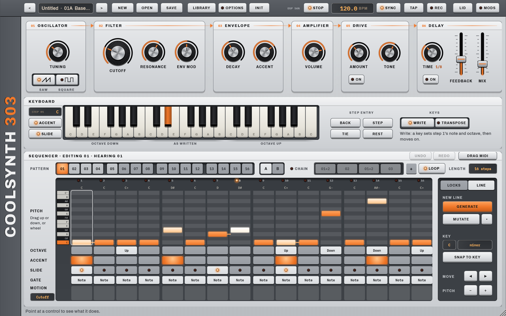
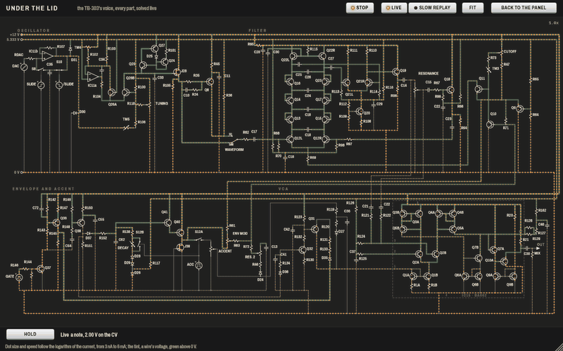

# CoolSynth 303



CoolSynth 303 is a bass line synthesizer modelled on the Roland TB-303.
Its oscillator, filter, envelope, VCA and output are the TB-303's circuits, solved part by part as the real ones work, and a step sequencer plays them with the original's accent, slide and timing.

It runs as a standalone app or as a VST3 plugin in your DAW.

Its siblings, built on the same sound engine: [CoolSynth 808](https://github.com/tomcoolpxl/CoolSynth808), a drum machine modelled on the TR-808's circuits, and [CoolSynth](https://github.com/tomcoolpxl/CoolSynth), a multi-engine synthesizer.

TB-303 is a trademark of Roland Corporation. CoolSynth 303 is not made, approved or endorsed by Roland; it is based on the machine's published service notes and checked against circuit simulations and recordings of a real unit.

## Download

Get the latest `CoolSynth303-Setup` installer from the [Releases page](https://github.com/tomcoolpxl/CoolSynth303/releases). CoolSynth 303 runs on 64-bit Windows 10 or 11.

Windows may warn that the publisher is unknown, because the installer isn't code-signed. Click **More info**, then **Run anyway**.

The installer puts the app in the Start menu and the VST3 in `C:\Program Files\Common Files\VST3`. Uninstalling it keeps your own lines and sounds.

The first time the app starts, Windows asks whether it may use the network. Allow it on private networks, so the beat sync can play in time with other computers.

## Sounds

The voice is the TB-303's own circuit, matched to circuit simulations of its service notes within a fraction of a cent and to recordings of a real unit within about a decibel:

- the oscillator's saw, and the square from its one-transistor shaper
- the diode ladder filter with its resonance, cutoff and envelope modulation
- the envelope and the accent's circuit, with the accent's sweep
- the VCA and the output stage: turned up high, loud accents flatten as a real unit's do
- the trimmers inside the case, as fitted to a real unit, in the Mods panel
- the Devil Fish, Robin Whittle's famous modification, switched on or off: more range on every knob, overdrive, slide time, filter tracking and FM, and more

After the voice come a drive and a tempo-synced delay.

The library has 30 original lines in ten styles, from Chicago 87 to rolling sub bass, and 12 sounds. Audition one in place of your pattern, load it, or keep a copy among your own.

The sequencer plays 16 patterns, each with an A and a B, and chains them. Each step has its note, octave, accent, slide and tie. It can write a new line in a key for you, mutate the one you have, record your knob moves into the pattern, and hold knob settings on single steps.



Lid lifts the lid: the whole voice as one schematic, with the current moving on its wires as it plays.

Options has the accuracy: Best, or Light for about 40 % less CPU with a slightly duller top octave. Exports always render at Best. Options also exports the pattern or the chain as a WAV file, cut, rung out or as a seamless loop.

How every part of the panel works is in the [manual](docs/manual.md).

## Playing with other gear

A MIDI keyboard plays the voice while the sequencer is stopped, and transposes the pattern while it plays.

The beat sync plays CoolSynth 303 in time with CoolSynth 808 and with DAWs and apps that speak the same protocol, on this computer or your network. It is on from the start: **SYNC** beside the tempo shows how many others are there, the tempo is shared, and Play and Stop on any of them start and stop them all on the bar line.

For hardware, CoolSynth 303 follows an incoming MIDI clock and sends its own.

In a DAW, the plugin follows the DAW's transport and tempo. Drag MIDI drags the pattern into your DAW as a MIDI file.

In the app, **Options > MIDI > Claude (MCP)** lets Claude Code read and set the panel and play the sequencer while it helps you. It is off until you switch it on, and only this computer can reach it.

## Building from source

On Windows, you need Git, CMake 3.22 or newer, and Visual Studio 2022 or its Build Tools.

```powershell
git clone --recurse-submodules https://github.com/tomcoolpxl/CoolSynth303.git
cd CoolSynth303
cmake -S . -B build -G "Visual Studio 17 2022" -A x64
cmake --build build --config Debug --parallel
ctest --test-dir build -C Debug --output-on-failure
```

Debug builds are optimized, so they play in real time. Use `--config Release` for a build you want to give to someone else.

How the sound is made, the tools and how a release is built are in [docs/development.md](docs/development.md).

## License

CoolSynth 303's own code is MIT licensed (see `LICENSE`). It's built with [JUCE](https://juce.com) 9 under the free [Starter licence](https://juce.com/legal/juce-9-licence/). The fonts are Archivo and IBM Plex Mono, under the SIL Open Font License. `THIRD_PARTY_NOTICES.txt`, which the installer ships beside the app, holds the notices of everything it includes.
